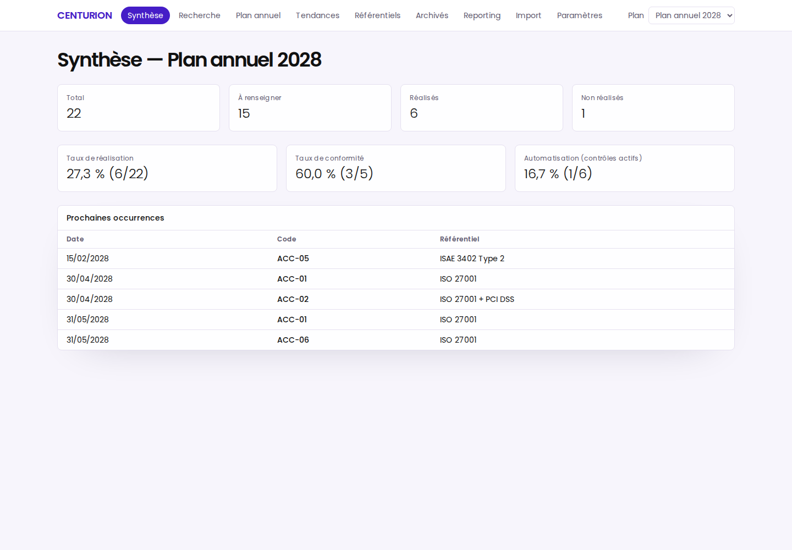
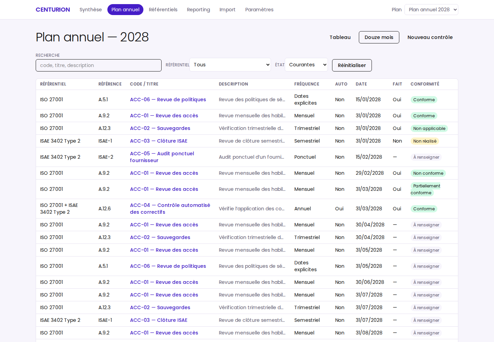
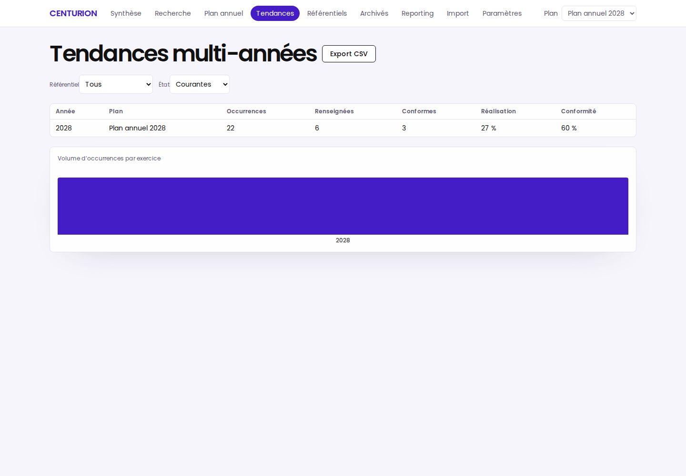

# CENTURION

Application locale mono-utilisateur de suivi d'un plan annuel de contrôles cyber
et IT : occurrences récurrentes, réalisations auditées, import CSV/XLSX revu,
reporting, tendances multi-années, mapping manuel de clauses, justificatifs
uploadés, sauvegardes/restauration et un adaptateur MCP stdio à capacités
limitées.

CENTURION est un projet indépendant. Ses exemples ISO 27001 et ISAE 3402 servent
à illustrer le suivi et la traçabilité ; ils ne constituent ni une évaluation de
conformité ni une opinion d'assurance.

> **[Notice d'utilisation illustrée](docs/NOTICE.md)** — installation, tour des
> écrans avec captures, workflows du quotidien et connexion MCP. Version page
> web autonome : [docs/notice.html](docs/notice.html).

## Captures d'écran

Captures réelles sur le jeu de démonstration (plan 2028) — régénérables via `npm run capture` :





## Prérequis

- Node.js 24 LTS (`>=24 <25`) et npm 11.
- Aucun accès réseau n'est requis au runtime ; aucune télémétrie, aucun CDN.

## Installation et lancement

```bash
npm ci
npm run build
npm run start          # UI compilée + API sur http://127.0.0.1:4317
```

Développement (backend + Vite sur 5173, données privées ordinaires) :

```bash
npm run dev
```

Démo reproductible (dataDir `data/demo`, horloge fixe 2028-04-15, plan 2028) :

```bash
npm run dev:demo       # seed si vide, aucun reset implicite
npm run demo:reset -- --confirm   # remet la démo à l'état déterministe
```

`demo:reset` refuse toute cible hors de `data/demo` et toute instance active.

## Stockage, sauvegardes, restauration

Le `dataDir` est `CENTURION_DATA_DIR` ou, par défaut, le répertoire utilisateur
de la plateforme (`%LOCALAPPDATA%/Centurion`, `~/.local/share/centurion`,
`~/Library/Application Support/Centurion`). Un seul processus possède SQLite et
les fichiers d'instance ; un verrou exclusif empêche une seconde instance.

- Sauvegardes cohérentes (`better-sqlite3.backup()`), catalogue externe durable,
  rétention 20 automatiques + tous les manuels.
- Restauration journalisée et récupérable après arrêt, avec aperçu 15 min,
  `pre_restore` conservé et nouvel `engine_epoch`.
- Imports/artefacts temporaires nettoyés au démarrage et périodiquement.

## MCP

Voir [`docs/MCP.md`](docs/MCP.md). En résumé : `npm run start` puis `npm run mcp`.
Lecture seule par défaut (dix outils) ; les écritures sont désactivées sauf
double flag (`CENTURION_MCP_WRITE=1` backend **et** adaptateur) et ne modifient
rien avant une approbation explicite dans l'UI CENTURION.

## MCP — connexion agnostique (tout hôte stdio)

CENTURION expose un serveur MCP via `stdio`, indépendamment de l’hôte. Les
exemples Claude Code/Codex/Claude Desktop dans `docs/MCP.md` sont des
illustrations ; le protocole et les variables d’environnement sont les mêmes
pour tout harness compatible MCP.

1. Démarrer le backend propriétaire :

```bash
npm run start
```

2. Configurer l’hôte MCP pour lancer ce processus stdio (variables recommandées) :

```bash
env CENTURION_DATA_DIR="$PWD/data/demo" "$PWD/scripts/mcp-stdio.sh"
```

3. Configuration générique `.mcp.json` (OpenCode, Codex, VS Code, etc.) :

```json
{
  "mcpServers": {
    "centurion": {
      "type": "stdio",
      "command": "/chemin/vers/CENTURION/scripts/mcp-stdio.sh",
      "env": {
        "CENTURION_DATA_DIR": "/chemin/vers/CENTURION/data/demo"
      }
    }
  }
}
```

4. Vérifier que l’hôte liste les outils disponibles. En lecture seule par
défaut : `list_plans`, `get_plan`, `list_controls`, `get_control`,
`list_occurrences`, `get_summary`, `get_trends`, `list_clauses`, `export_controls_csv`, `generate_report_pdf`.
Les écritures ne s’activent que via Paramètres → Permissions MCP.

Voir [`docs/MCP.md`](docs/MCP.md) pour les détails Claude Desktop, Codex,
Windows natif, limites, jeton runtime et frontière de confiance.

## Qualité

```bash
npm run check          # typecheck + lint + tests unitaires/intégration/sécurité/MCP
npm run test:e2e       # Playwright Chromium contre un build de production
npm run audit:deps     # npm audit --omit=dev --audit-level=high (réseau requis)
```

## Limites et hors périmètre

- Mono-utilisateur, sans compte ni SSO ; le MVP protège les requêtes du
  navigateur, pas les autres processus du même poste.
- Aucune notion automatique de retard/SLA, aucun chiffrement applicatif, aucune
  inviolabilité de l'audit. Les justificatifs sont bornés et typrés, mais ne
  sont pas scannés par antivirus.
- MCP stdio uniquement (pas de transport réseau) ; les données renvoyées à un
  host IA peuvent être transmises par ce host à son fournisseur.
- Voir `docs/EXECUTION.md` pour l'état exact, les preuves et les sous-points
  restant à couvrir.

## Licence

Code MIT (`LICENSE`). Police Poppins sous SIL Open Font License 1.1
(`licences/Poppins-OFL.txt`).
