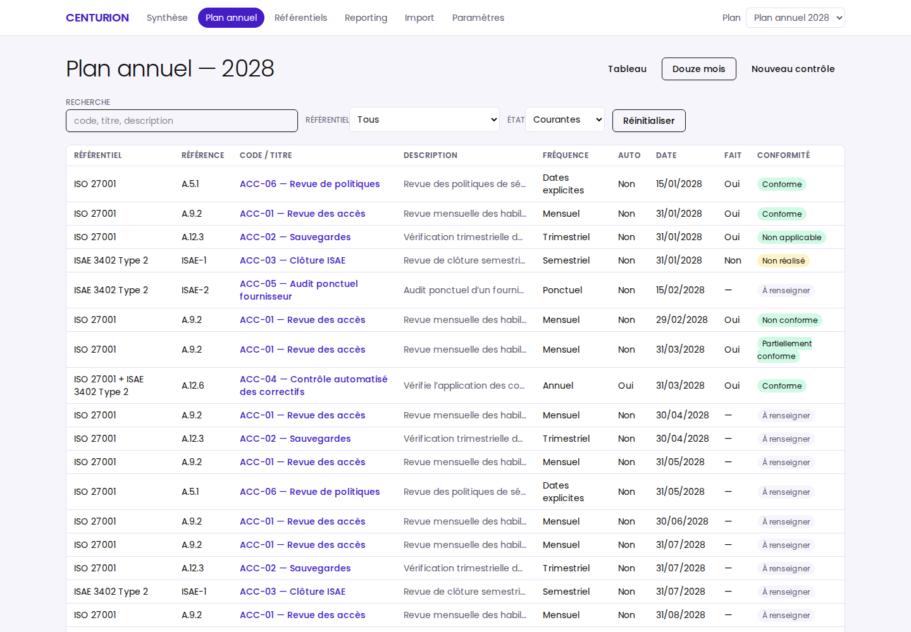

# <picture><source srcset="docs/brand/centurion-logo-dark.svg" media="(prefers-color-scheme: dark)"></picture>

**C**ontrôles, **É**chéances, **N**ormes, **T**raçabilité : **U**n **R**egistre **I**ndépendant, **O**uvert, **N**atif

**C**ontrols, **E**vidence, **N**orms & **T**racking: a **U**nified **R**egister, **I**ndependent, **O**pen, **N**ative

[](https://github.com/msafla/centurion/actions/workflows/check.yml)

CENTURION est un outil local de suivi d'un plan annuel de contrôles cyber et IT. Il répond à un besoin concret : voir quelles occurrences tombent dans l'année, lesquelles ont été réalisées et avec quels justificatifs, sans envoyer ces données sur un SaaS. L'application tourne sur votre poste, dans un conteneur Docker, et ses données ne quittent la machine que si vous la branchez à un assistant IA via MCP.

Le dépôt sert aussi de référence d'implémentation : voici comment on peut construire ce genre d'outil — API Fastify, base SQLite, interface React/Vite, tests, image Docker durcie et scannée en CI. Si votre besoin est proche, reprenez le code et adaptez-le.

La documentation d'utilisation est en français.

> **[Notice d'utilisation illustrée](docs/NOTICE.md)** — installation, tour des écrans avec captures, workflows du quotidien et connexion MCP. Version page web autonome : [docs/notice.html](docs/notice.html).

## English summary

**C**ontrols, **E**vidence, **N**orms & **T**racking: a **U**nified **R**egister, **I**ndependent, **O**pen, **N**ative.

CENTURION is a local-first, single-user app for tracking an annual cyber/IT control plan: recurring occurrences, audited completions, evidence uploads, multi-year trends, CSV/PDF exports, backups and restore, plus a read-only-by-default MCP stdio server. Built with TypeScript, Fastify, SQLite and React/Vite, it runs on Linux through a hardened Docker image. It is written as a reference implementation — tested, hardened and scanned — that you can take and adapt if your need is close. Documentation is in French.

## Captures d'écran

Captures réelles sur le jeu de démonstration (plan 2028), régénérables via `npm run capture` :





## Ce que fait l'outil

- Plan annuel de contrôles avec occurrences récurrentes (mensuel, trimestriel, semestriel, annuel ou dates explicites), générées à partir d'une date d'ancrage.
- Réalisations auditées : conformité, date de réalisation, commentaire, référence de preuve ; les corrections gardent leur identifiant et sont journalisées (avant/après).
- Justificatifs uploadés (PDF, PNG, JPEG ou TXT, ≤ 5 MiB), stockés sous le répertoire de données avec leur hash SHA-256.
- Tendances multi-années, mapping manuel de clauses de référentiels, recherche globale, archivage des contrôles.
- Exports CSV et PDF bornés (rapport PDF limité à 1 000 occurrences), import CSV/XLSX revu puis appliqué de façon atomique.
- Sauvegardes cohérentes et restauration journalisée.
- Serveur MCP en stdio, lecture seule par défaut.

Les exemples ISO 27001 et ISAE 3402 servent à illustrer le suivi et la traçabilité ; ils ne constituent ni une évaluation de conformité ni une opinion d'assurance.

## Démarrage (Docker)

Plateforme supportée : **Linux, via Docker**. Windows et macOS ne sont pas supportés nativement. Aucun accès réseau n'est requis au runtime ; aucune télémétrie, aucun CDN.

```bash
docker compose up -d --build
```

Ouvrez <http://127.0.0.1:4317> dans votre navigateur. Le port 4317 n'est publié que sur `127.0.0.1` de l'hôte.

## Données et sauvegardes

Dans Docker, les données vivent dans le volume nommé `centurion-data` monté sur `/data`, avec `CENTURION_DATA_DIR=/data/app` dans l'image : le verrou d'instance `<dataDir>.lock` est un frère du répertoire de données et doit rester dans le volume inscriptible, pas à la racine du système de fichiers en lecture seule. Hors Docker (développement), c'est `CENTURION_DATA_DIR` ou `~/.local/share/centurion` sous Linux. Un seul processus possède SQLite et les fichiers d'instance ; un verrou exclusif bloque une seconde instance.

- Sauvegardes cohérentes (`better-sqlite3.backup()`), catalogue externe durable, rétention de 20 sauvegardes automatiques plus toutes les manuelles.
- Restauration journalisée, avec aperçu de 15 minutes, `pre_restore` conservé et nouvel `engine_epoch` ; reprise possible après un arrêt.
- Imports et artefacts temporaires nettoyés au démarrage et périodiquement.

## MCP

Voir [`docs/MCP.md`](docs/MCP.md) pour le détail. En résumé :

```bash
docker compose up -d --build
docker exec -i centurion /nodejs/bin/node dist/mcp/server.js
```

Le serveur MCP tourne en stdio, quel que soit l'hôte (Claude Code, Codex, VS Code, OpenCode, Claude Desktop…). Exemple de configuration `.mcp.json` :

```json
{
  "mcpServers": {
    "centurion": {
      "type": "stdio",
      "command": "docker",
      "args": ["exec", "-i", "centurion", "/nodejs/bin/node", "dist/mcp/server.js"]
    }
  }
}
```

En développement (hors Docker, Linux + Node 24), le lanceur `scripts/mcp-stdio.sh` reste disponible :

```bash
env CENTURION_DATA_DIR="$PWD/data/demo" "$PWD/scripts/mcp-stdio.sh"
```

Lecture seule par défaut, dix outils : `list_plans`, `get_plan`, `list_controls`, `get_control`, `list_occurrences`, `get_summary`, `get_trends`, `list_clauses`, `export_controls_csv`, `generate_report_pdf`. Les écritures (`create_control`, `update_control_metadata`, `set_occurrence`) sont désactivées par défaut ; on les active par permission dans Paramètres → Permissions MCP, et chaque appel d'écriture ne crée qu'une proposition, qui ne modifie aucune donnée avant une approbation explicite dans l'UI (Paramètres → Approbations MCP).

**Attention** : les données renvoyées à un hôte IA peuvent être transmises par cet hôte à son fournisseur de modèle.

## Durcissement du conteneur

- Image `gcr.io/distroless/nodejs24-debian13:nonroot` : pas de shell, pas de gestionnaire de paquets ; exécution sous l'UID 65532 (non-root).
- Système de fichiers racine en lecture seule (`read_only: true`) avec `tmpfs /tmp` ; `cap_drop: [ALL]` ; `no-new-privileges:true` ; `pids_limit: 128` ; `mem_limit: 512m`.
- Port publié uniquement sur `127.0.0.1:4317:4317`.
- `HEALTHCHECK` en Node (forme exec, sans shell) sur `GET /health`.
- Scan Trivy (sévérité CRITICAL) de l'image dans la CI GitHub, qui tourne sur Ubuntu avec trois jobs : `check`, `e2e` et `docker`.

## Développement

Prérequis : Linux, Node.js 24 LTS (`>=24 <25`) et npm 11.

```bash
npm ci
npm run dev          # backend + Vite sur 5173
npm run dev:demo     # démo reproductible (dataDir data/demo, horloge fixe 2028-04-15, plan 2028)
npm run demo:reset -- --confirm   # remet la démo à l'état déterministe (refuse hors data/demo et si une instance tourne)
npm run build
npm run start        # UI compilée + API sur http://127.0.0.1:4317
```

Qualité :

```bash
npm run check          # typecheck + lint + 177 tests (unitaires, intégration, sécurité, MCP)
npm run test:e2e       # 9 scénarios Playwright Chromium contre un build de production
npm run audit:deps     # npm audit --omit=dev --audit-level=high (réseau requis)
```

## Avant de le reprendre

CENTURION est mono-utilisateur : pas de comptes, pas de SSO, pas de rôles. Le journal d'audit n'est pas infalsifiable et n'a aucune valeur de preuve pour un auditeur. Il n'y a pas de support ni de feuille de route garantie. Pour un outil GRC multi-utilisateur complet, des projets open source comme CISO Assistant (intuitem) ou eramba couvrent un périmètre plus large ; CENTURION se limite volontairement au suivi du plan annuel de contrôles et se lit en un après-midi.

## Limites et hors périmètre

- Mono-utilisateur, sans compte ni SSO ; l'application protège les requêtes du navigateur (Origin, en-tête `X-Centurion-Request`, hôte), pas les autres processus du même poste.
- Pas de notion automatique de retard/SLA, pas de chiffrement applicatif, pas d'inviolabilité de l'audit. Les justificatifs sont bornés et typés, mais ne sont pas scannés par antivirus.
- MCP stdio uniquement (pas de transport réseau).
- Voir `docs/process/EXECUTION.md` pour l'état exact de l'implémentation.

## Licence

Code MIT (`LICENSE`). Police Poppins sous SIL Open Font License 1.1 (`licences/Poppins-OFL.txt`).
