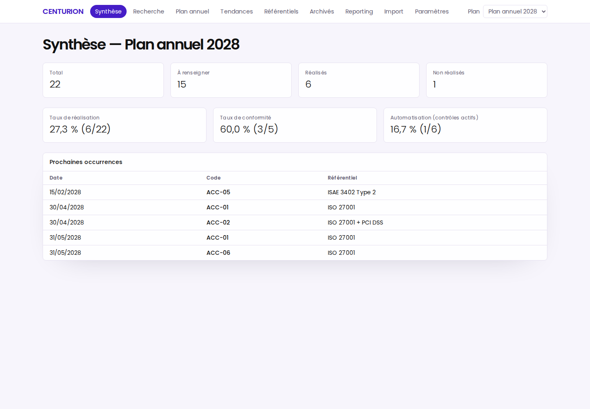
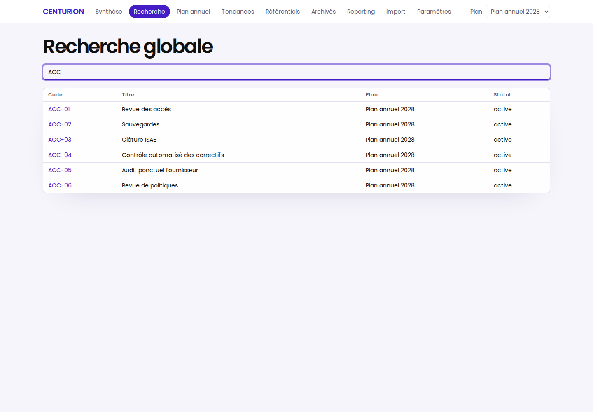
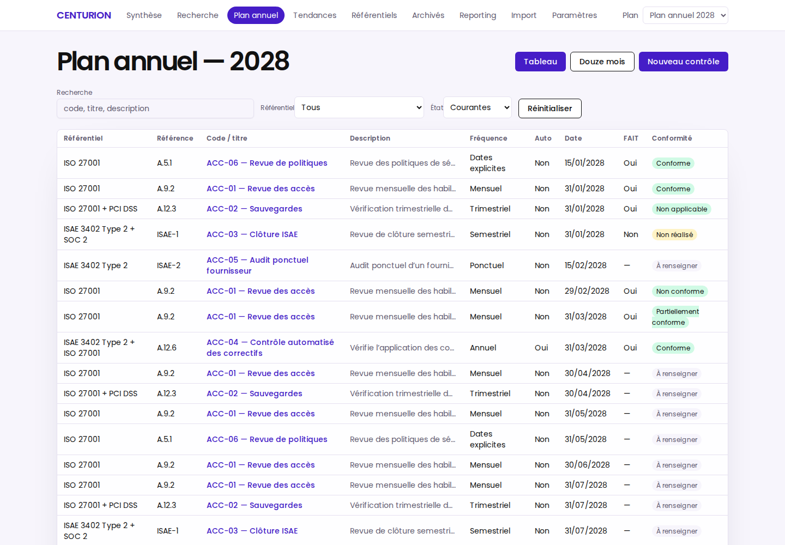
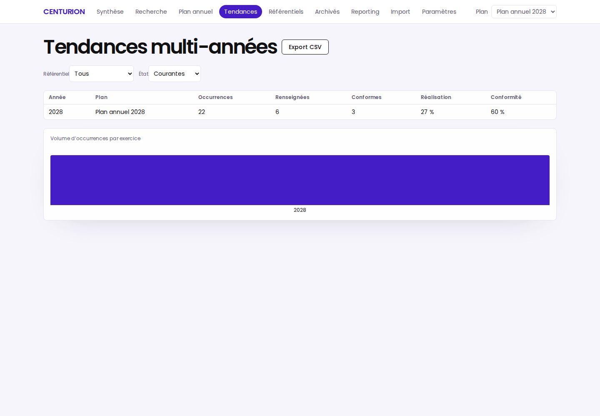
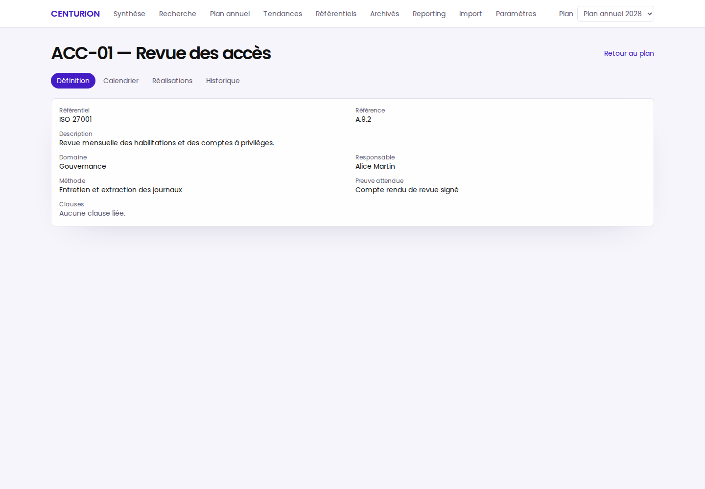
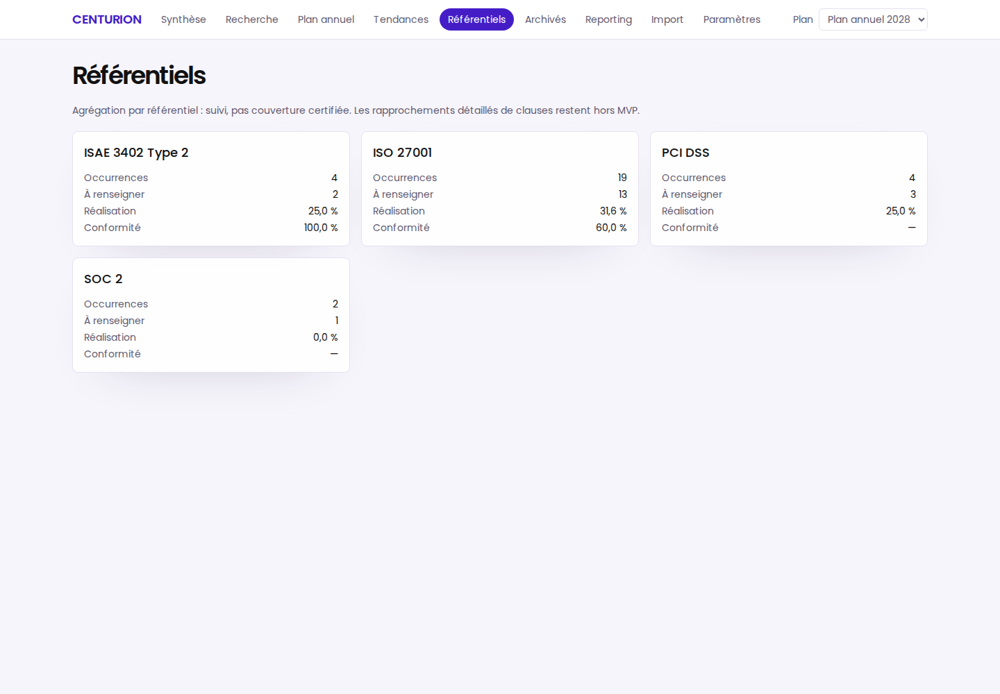
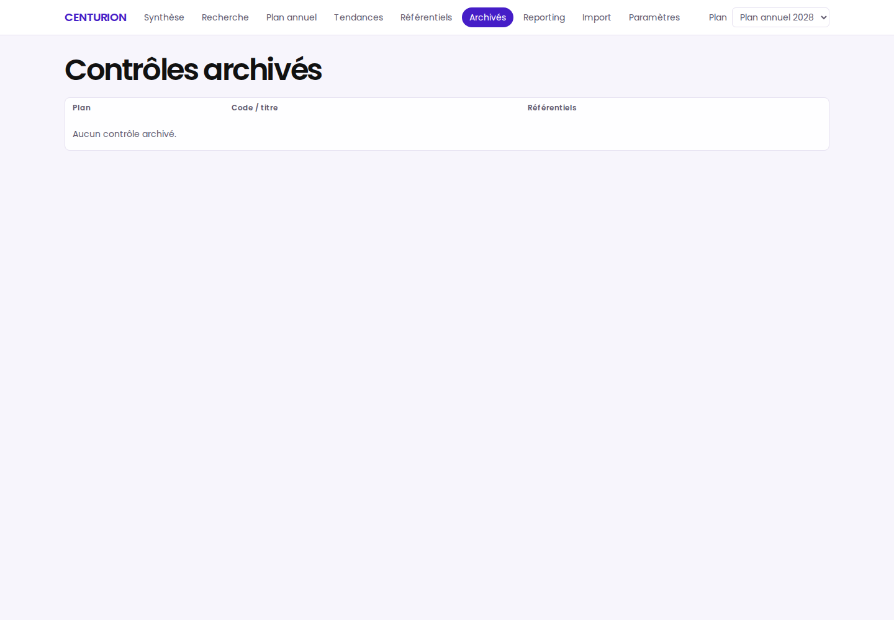
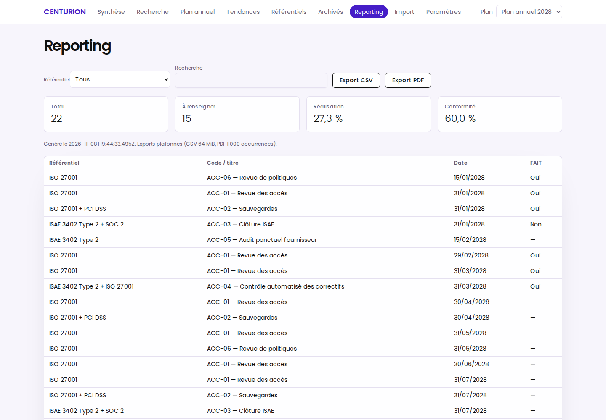
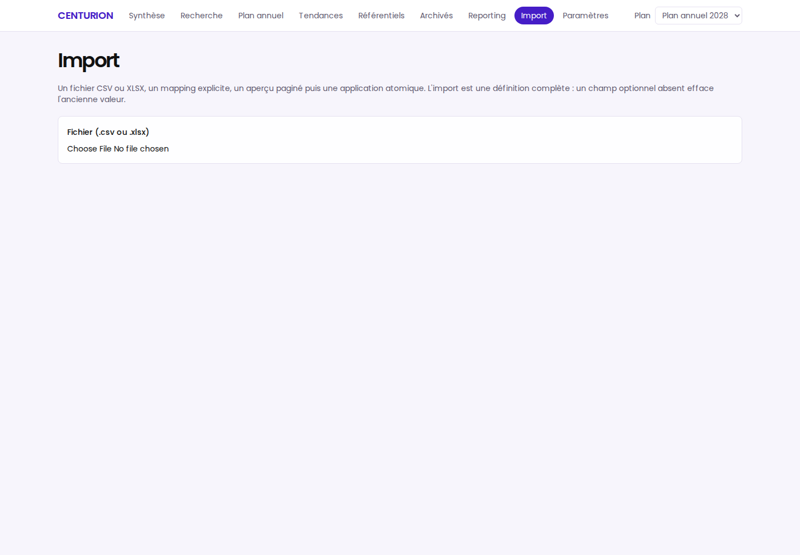
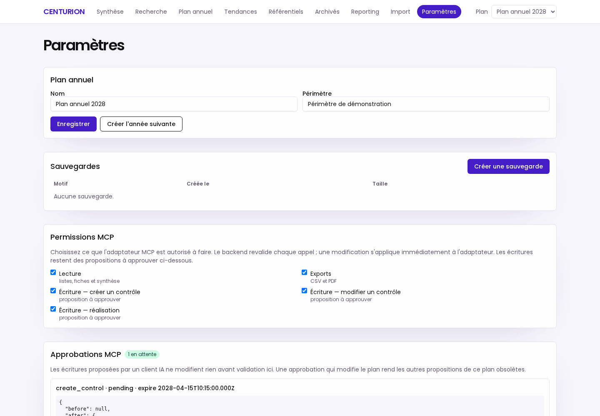

# CENTURION — Notice d'utilisation

Application **locale et mono-utilisateur** de suivi d'un plan annuel de contrôles
cyber et IT : occurrences récurrentes, réalisations auditées, justificatifs,
tendances multi-années, exports, sauvegardes — et un serveur MCP pour piloter
les données depuis un assistant IA.

> CENTURION est un outil de suivi et de traçabilité. Ses exemples ISO 27001 /
> ISAE 3402 / PCI DSS servent à illustrer le suivi ; ils ne constituent **ni
> une évaluation de conformité, ni une opinion d'assurance**.

Toutes les captures ci-dessous sont des écrans réels de l'application, prises sur
le jeu de données de démonstration (`npm run dev:demo`).

---

## 1. Installation et lancement

Prérequis : **Node.js 24 LTS** (`>=24 <25`) et npm 11. Aucun accès réseau
n'est requis au runtime.

```bash
npm ci
npm run build
npm run start        # UI + API sur http://127.0.0.1:4317
```

Ouvrez <http://127.0.0.1:4317> dans votre navigateur. L'application n'écoute que
sur `127.0.0.1` ; un seul processus peut accéder aux données (verrou d'instance).

**Démo reproductible** (données fictives, horloge fixe 2028-04-15, plan 2028) :

```bash
npm run dev:demo                 # seed si vide, aucun reset implicite
npm run demo:reset -- --confirm  # retour à l'état déterministe (data/demo uniquement)
```

Les données vivent dans `CENTURION_DATA_DIR`, ou par défaut dans le répertoire
utilisateur de la plateforme (`~/.local/share/centurion` sous Linux,
`%LOCALAPPDATA%/Centurion` sous Windows, `~/Library/Application Support/Centurion`
sur macOS).

---

## 2. Tour des écrans

La barre de navigation en haut donne accès à toutes les pages ; le sélecteur à
droite choisit le plan annuel actif.

### Synthèse

Vue d'ensemble du plan sélectionné : compteurs (total, à renseigner, réalisés,
non réalisés), taux de réalisation / conformité / automatisation, et prochaines
occurrences à traiter.



### Recherche

Recherche globale sur les contrôles (code, titre, description), résultats
plafonnés à 50, contrôles archivés inclus.



### Plan annuel

Tableau des occurrences de l'année avec filtres (texte, référentiel, état),
pagination, et vue « Douze mois ». Le bouton **Nouveau contrôle** ouvre la
fiche de création.



### Tendances

Évolution multi-années : un point par exercice (occurrence, réalisation,
conformité) avec les mêmes filtres, tableau + graphique, et export CSV.



### Fiche contrôle

Définition du contrôle (référentiels, clauses, responsables…), calendrier et
aperçu de changement de planning, réalisations avec justificatifs, et historique
d'audit (qui a modifié quoi, quand).



### Référentiels

Agrégation par référentiel (ISO 27001, ISAE 3402 Type 2, combinés) : suivi par
famille, pas une couverture certifiée.



### Archivés

Liste des contrôles archivés de tous les plans, avec leur exercice d'origine.



### Reporting

Rapport filtrable avec exports **CSV** (toutes les occurrences filtrées) et
**PDF** (rapport paginé, borné à 1 000 occurrences).



### Import

Import **CSV/XLSX** revu : upload, mapping explicite des colonnes, aperçu paginé
(create / update / unchanged / invalid), puis application **atomique**.



### Paramètres

Nom et périmètre du plan, création de l'année suivante, **sauvegardes** (créer,
restaurer avec aperçu), **permissions MCP** et approbations des écritures
proposées par un assistant IA.



---

## 3. Les workflows du quotidien

### Créer un contrôle

Plan annuel → **Nouveau contrôle** : code, titre, description, référentiels,
fréquence (mensuel / trimestriel / semestriel / annuel / dates explicites) et
date d'ancrage. Les occurrences de l'année sont générées automatiquement.

### Renseigner une réalisation

Depuis le plan annuel, cliquez sur le badge de conformité d'une occurrence :
**FAIT** oui/non, conformité (conforme, partiellement conforme, non conforme,
non applicable — forcée à *non applicable* si FAIT = non), date de réalisation
(antérieure acceptée, future refusée), commentaire, référence de preuve.
Les corrections gardent le même identifiant et sont auditées (avant/après).

### Joindre des justificatifs

Dans la fiche contrôle, onglet **Réalisations** : déposez un fichier
(**PDF, PNG, JPEG ou TXT, ≤ 5 MiB**) sur une occurrence. Le fichier est stocké
sous le répertoire de données (hash SHA-256), téléchargeable, supprimable.
Les justificatifs sont bornés et typés, mais **non scannés par antivirus**.

### Lier des clauses

Fiche contrôle → onglet **Définition** → section **Clauses** : cochez les clauses
à associer (créables via l'API `POST /api/clauses`) et enregistrez. La synthèse
et les tendances agrègent alors la couverture par clause.

### Archiver un contrôle

Fiche contrôle → onglet **Calendrier** : choisissez une **date d'effet** puis
**Archiver**. Les occurrences ouvertes à partir de cette date passent
« supplantées », les réalisées sont conservées telles quelles. L'archivage est
réversible visuellement via la page **Archivés**.

### Sauvegarder et restaurer

Paramètres → **Sauvegardes** : sauvegarde cohérente (copie SQLite à chaud),
rétention 20 automatiques + manuelles, restauration journalisée avec aperçu
de 15 minutes et reprise possible après arrêt.

---

## 4. Connecter un assistant IA (MCP)

CENTURION expose un serveur **MCP en stdio**, agnostique de l'hôte (OpenCode,
Codex, VS Code, Claude Desktop…) :

1. Démarrez le backend : `npm run start`
2. Dans la configuration MCP de votre hôte (ex. `.mcp.json`) :

```json
{
  "mcpServers": {
    "centurion": {
      "type": "stdio",
      "command": "/chemin/vers/CENTURION/scripts/mcp-stdio.sh",
      "env": { "CENTURION_DATA_DIR": "/chemin/vers/CENTURION/data/demo" }
    }
  }
}
```

**Lecture seule par défaut — 10 outils** : `list_plans`, `get_plan`,
`list_controls`, `get_control`, `list_occurrences`, `get_summary`, `get_trends`,
`list_clauses`, `export_controls_csv`, `generate_report_pdf`.

Les **écritures** (`create_control`, `update_control_metadata`, `set_occurrence`)
nécessitent le double flag `CENTURION_MCP_WRITE=1` (backend **et** adaptateur)
**et** ne modifient rien avant une approbation explicite dans l'UI
(Paramètres → Approbations MCP). Activez/désactivez chaque permission dans
Paramètres → Permissions MCP.

Voir [`docs/MCP.md`](MCP.md) pour les détails (jeton runtime, limites, frontière
de confiance). Attention : les données renvoyées à l'hôte IA peuvent être
transmises par cet hôte à son fournisseur de modèle.

---

## 5. Sécurité et limites

- Mono-utilisateur, sans compte ni SSO ; l'app protège les requêtes du navigateur
  (Origin, en-tête `X-Centurion-Request`, hôte) mais pas les autres processus du
  même poste.
- Aucune donnée ne quitte la machine, sauf via le serveur MCP stdio (voir ci-dessus).
- Pas de notion automatique de retard/SLA, pas de chiffrement applicatif, pas
  d'inviolabilité de l'audit.
- MCP en stdio uniquement (pas de transport réseau).

---

## 6. Commandes utiles

```bash
npm run check        # typecheck + lint + tests unitaires/intégration/sécurité/MCP
npm run test:e2e     # tests Playwright contre un build de production
npm run diagnose     # état rapide des artefacts de build
npm run audit:deps   # npm audit (réseau requis)
```

Régénérer les captures de cette notice :

```bash
npm run build && npm run seed:demo
CENTURION_DATA_DIR="$PWD/data/demo" npm run start &
node scripts/capture-screenshots.mjs   # écrit docs/screenshots/*.png
```
